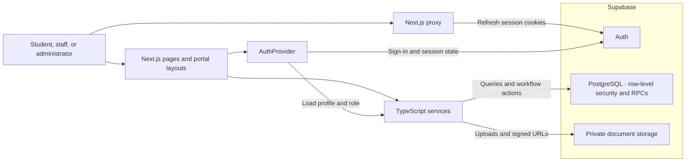

# University Enrollment System

A web portal for university admissions. Students can apply online and track their progress. Admissions staff review applications and supporting documents, while administrators manage the programs and enrollment periods available to applicants.

| Portal | What you can do | Entry point |
| --- | --- | --- |
| Student | Create an account, complete an enrollment form, select program choices, upload documents, submit an application, and track decisions and notifications. | `/register`, `/student/dashboard` |
| Admissions staff | Browse applications, verify documents, and approve, reject, or request corrections. | `/staff/dashboard` |
| Administrator | Manage faculties, departments, majors, and enrollment periods. View analytics and export application data as CSV. | `/admin/programs`, `/admin/periods`, `/admin/analytics` |

All roles sign in at `/login`.

## Run locally

You’ll need Node.js 24, pnpm, the Supabase CLI, and a running Docker engine for local Supabase.

### 1. Install dependencies and start Supabase

Run these commands from the repository root:

```cmd
pnpm install --frozen-lockfile
supabase start
supabase status
copy .env.example .env.local
```

Set these variables in `.env.local` using the local API URL and public client key shown by Supabase. Use the publishable key if available, or the legacy anon key.

```dotenv
NEXT_PUBLIC_SUPABASE_URL=http://127.0.0.1:54321
NEXT_PUBLIC_SUPABASE_PUBLISHABLE_KEY=<public-client-key>
```

Use a publishable or anon key in the `NEXT_PUBLIC_*` variables, which are exposed to the browser.

For a hosted Supabase project, apply the SQL files in [`supabase/migrations/`](supabase/migrations/) in timestamp order and use that project’s URL and publishable key.

### 2. Start the web app

```cmd
pnpm dev
```

Open [http://localhost:3000](http://localhost:3000). If your Supabase project requires email confirmation, confirm the registration email before signing in.

### 3. Set up the first enrollment cycle

1. Register a dedicated administrator account through `/register`. Registration creates an `applicant` role by default.
2. In Supabase Studio or the hosted SQL editor, use the account’s Auth user UUID to update its role:

   ```sql
   update public.user_roles
   set role = 'admin'
   where user_id = '<auth-user-uuid>'
     and role = 'applicant';
   ```

   For a dedicated staff account, use `admission_officer` or `registrar` in place of `admin`. Sign in again after changing the role.
3. As the administrator, create an active faculty, department, and major under `/admin/programs`. Open an enrollment period under `/admin/periods` with dates that include today.
4. Register a separate student account, start an application, and submit it with the required documents. Sign in as staff to review the submission, then check the student’s status and notifications.

## System architecture

The system runs as a single Next.js 16 App Router application backed by Supabase. The public site and all three portals share React 19 components, TypeScript types, and Tailwind CSS 4 styles. Portal pages call TypeScript services that use the Supabase browser client for data access.



- **Sessions and permissions.** Supabase Auth manages sessions, the Next.js proxy refreshes session cookies, and portal layouts use the account role to control navigation. PostgreSQL row-level security and Storage policies enforce access to records and files.
- **Application workflow.** Students save and submit applications through database functions called by the application service. Staff review applications and documents through the same service layer. SQL functions and triggers handle status changes, history, and notifications.
- **Document storage.** Uploaded files live in the private `application-documents` bucket. PostgreSQL stores each document’s application ID, storage path, and review status. The service generates time-limited signed URLs for viewing.

### Project structure

| Path | Responsibility |
| --- | --- |
| [`app/`](app/) | Public pages, role-based portals, shared UI components, and styles |
| [`src/services/`](src/services/) | Data access for applications, documents, programs, profiles, reviews, and notifications |
| [`src/lib/supabase/`](src/lib/supabase/) | Browser and server clients and session refresh |
| [`src/providers/`](src/providers/) | Authentication state for the UI |
| [`src/types/`](src/types/) | Application and database types |
| [`supabase/migrations/`](supabase/migrations/) | Database schema, access policies, storage setup, and application workflow functions |
| [`docs/`](docs/) | [UI/UX specification](docs/index.md), [implementation phases](docs/phase.md), and [package reference](docs/package.md) |

## Development checks

```cmd
pnpm lint
pnpm exec tsc --noEmit
pnpm build
```

Run `pnpm start` after a successful build to serve the production build locally.
